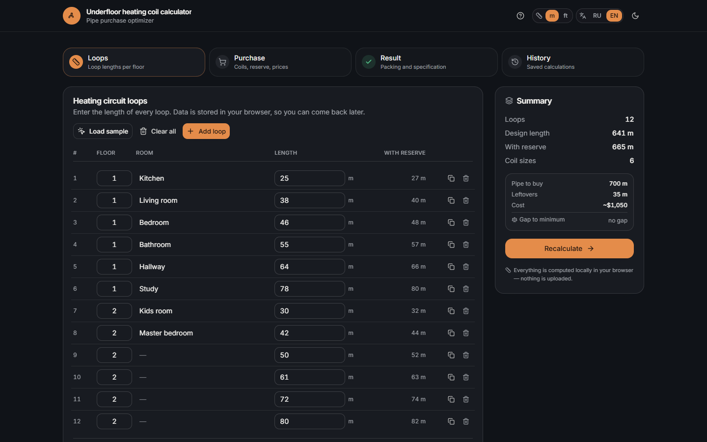
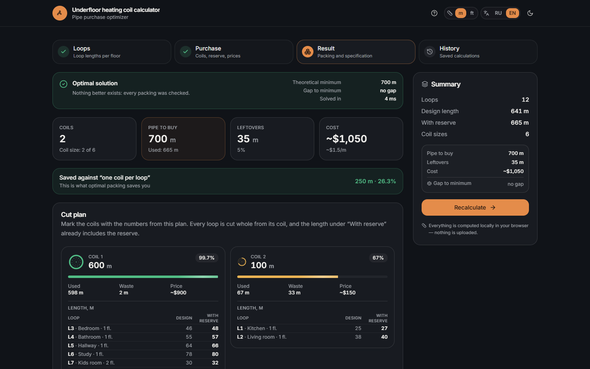
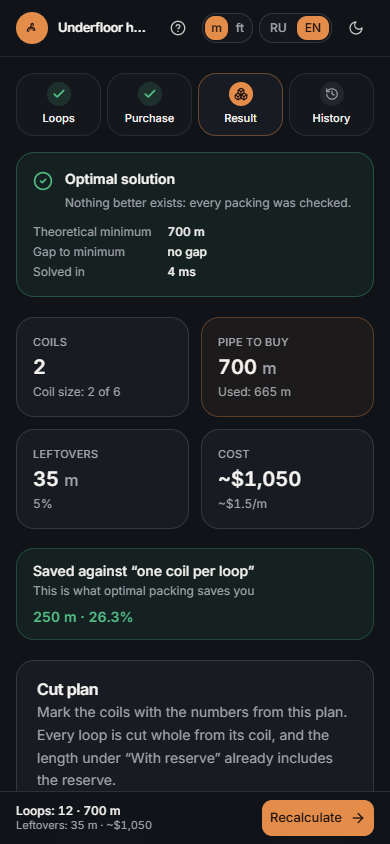
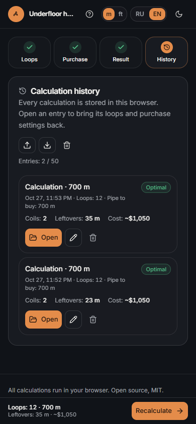

# Underfloor heating coil optimizer

[](https://github.com/ena-ean/underfloor-coil-optimizer/actions/workflows/ci.yml)
[](LICENSE)
[](https://hub.docker.com/r/enaresearch/underfloor-coil-optimizer)

Packs underfloor heating loops into fixed-size pipe coils with as little leftover
as possible, and says how close the plan is to the mathematical minimum. Runs in
the browser: no accounts, no backend, no tracking.

**Live demo:** <https://coilcalculator.enaserver.ru/>

<p align="center">
  
  
</p>

<p align="center">
  
  
</p>

## What it does

Paste a column of lengths from Excel, pick the coil sizes you can buy, and the
plan appears as you type: a cut plan grouped by coil that gives the design and the
reserve length of every loop, the purchase specification, and the saving against
buying one coil per loop. The reserve is already inside the length to cut, so the
same numbers work on site and at the till. One exact search either proves that no
cheaper set of coils exists or reports how much room is still left, so a zero gap
always means optimal. "Load sample" fills twelve loops on two floors, from 25 to
80 m, if you just want to see the tool at work.

The cut plan is also what the printout, the CSV and the standalone HTML report
carry, so the sheet handed to the installer and the screen cannot disagree. A loop
can carry an optional room name, which travels into all three and leaves every
table as short as it was for an unnamed loop.

Results print or save as PDF, export to CSV for Excel, or save as a standalone
HTML report, and each calculation stays in a local history with its inputs. The
interface is Russian and English, dark by default, usable on a phone, and switches
every length between metres and feet without touching the stored calculation.
Prices are reference figures: the per-metre value is an average, coils of one size
cost differently per supplier, so every total carries a `~`.

## Run it

The published image targets `linux/amd64`. Tags `1.3.0` and `latest` are the same
build, under 60 MB compressed, and the container runs as a non-root user:

```bash
docker run --rm -p 3000:3000 enaresearch/underfloor-coil-optimizer:latest
```

Or with Compose, which needs nothing but this block — the image already sets
`NODE_ENV`, the telemetry switch and the healthcheck:

```yaml
services:
  coil-optimizer:
    image: enaresearch/underfloor-coil-optimizer:latest
    container_name: coil-optimizer
    ports:
      - "${PORT:-3000}:3000"
    restart: unless-stopped
```

The same configuration ships as `docker-compose.yml`, so a clone can run
`docker compose up -d` and rebuild locally with `--build`.

Both options serve <http://localhost:3000>. `PORT=8080 docker compose up -d`
moves it. To build the image yourself, run the dev server or the test suite, see
[docs/building.md](docs/building.md).

## How it packs

All arithmetic happens in integer millimetres, so a float comparison never
decides whether a loop fits. One search does the work: a depth-first branch and
bound over whole coils. The longest unpacked loop always goes into the coil
being built, loops of equal length are counted as a multiplicity instead of as
separate items, and a coil that could still take a loop without growing to the
next size is rejected, because moving that loop in is free.

A greedy pass with local search only supplies the first upper bound, so it can
change how long the search takes but never what it returns. There is no node or
time budget: the search either finishes, and the plan is then optimal, or the
page says that it is still running or was stopped, next to the best plan found so
far. The search runs in a Web Worker, so even a long one never freezes the
interface.

The lower bound is the second half of the story. Every plan is a sum of coil
sizes, therefore a multiple of their greatest common divisor, so
`ceil(total / gcd) × gcd` cannot be beaten. Plans are compared by purchased
length first and by the number of coils second, and prices only describe the
finished plan.

## Releases

Changes of every version are in [CHANGELOG.md](CHANGELOG.md) and releases are
tagged in this repository (`v1.3.0`). The container image is published on
[Docker Hub](https://hub.docker.com/r/enaresearch/underfloor-coil-optimizer).

## License

[MIT](LICENSE) © 2026 ena-ean
