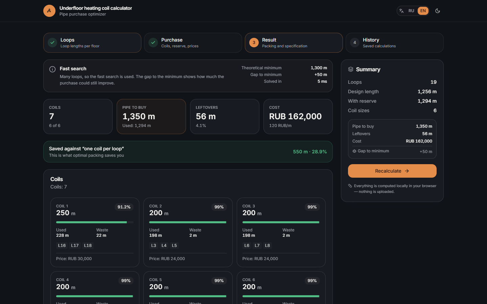
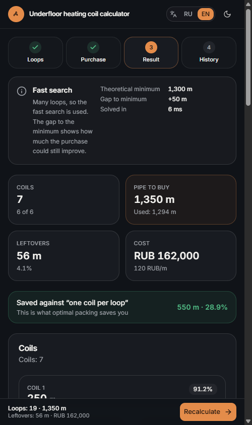

# Underfloor heating coil optimizer

[](https://github.com/ena-ean/underfloor-coil-optimizer/actions/workflows/ci.yml)
[](LICENSE)
[](https://hub.docker.com/r/enaresearch/underfloor-coil-optimizer)

Packs underfloor heating circuit loops into purchasable pipe coils (50–600 m)
so that the leftover pipe — and, optionally, the money — is as small as
possible. Runs entirely in the browser, no backend, no accounts, no tracking.

<p align="center">
  
  
</p>

<p align="center">
  
</p>

## Why

A craftsman writes down 19 loops (≈ 1 300 m of pipe) and buys "one coil per
loop" — that is 3 800 m of pipe instead of 1 350 m. A naive sum of the lengths
is not enough either: coil sizes are fixed, and splitting 2ⁿ combinations by
hand does not work. The optimizer solves the packing problem properly and shows
how far the result is from the theoretical minimum.

## Features

- **Two objectives** — minimum purchased metres or minimum cost (with prices per
  metre that may differ per coil size).
- **Provable quality** — a lower bound on the purchase and the gap to it; when
  the gap is zero the plan is optimal by definition. Up to 13 loops the solver
  runs an exact branch-and-bound search.
- **Live recalculation** as you type, with the purchase specification, per-coil
  fill percentage and the loop → coil distribution.
- **Savings** compared to the naive "one coil per loop" purchase.
- **Excel paste** — copy a column of lengths and paste it into the loop list.
- **Exports** — print/PDF stylesheet, CSV for Excel, standalone HTML report.
- **Calculation history** — every packing is saved locally with its loops and
  purchase settings; open an entry to bring them back, rename it, delete it, or
  export/import the whole list as JSON. Recalculating the same inputs updates the
  existing entry instead of adding a duplicate.
- **Russian + English**, starting in the language of the system, dark theme by
  default (light is one click away), keyboard-friendly, responsive down to 320 px.
- **Offline** — everything is computed client-side and stored in
  `localStorage` behind versioned keys.

## Quick start

Requires **Node.js 20 or newer** (CI runs 22) and npm. Docker is optional and
only needed for the container image.

```bash
npm ci
npm run dev            # http://localhost:3000
```

Production preview:

```bash
npm run build
npm start
```

### Docker

```bash
docker compose up --build      # http://localhost:3000
# or run the published image (linux/amd64)
docker run --rm -p 3000:3000 enaresearch/underfloor-coil-optimizer:1.0.0
# or build from source
docker build -t coil-optimizer .
docker run --rm -p 3000:3000 coil-optimizer
```

The image is a multi-stage build (≈ 221 MB, non-root, `HEALTHCHECK` on
`/api/health`). Change the published port with `PORT=8080 docker compose up`.
Prebuilt images are published to Docker Hub as
[`enaresearch/underfloor-coil-optimizer`](https://hub.docker.com/r/enaresearch/underfloor-coil-optimizer)
(`linux/amd64`, tags `1.0.0` and `latest`, ≈ 57 MB compressed).

## How the packing works

1. Everything is converted to integer **millimetres**, so no float comparison
   ever decides a fit.
2. **Heuristic** — best-fit greedy with a one-step lookahead (three input
   orders) followed by local search over four neighbourhoods: move a loop, swap
   two loops, merge two coils, split a coil. Every accepted move strictly
   improves the score.
3. **Exact solver** (≤ 13 loops, node + time budget) — branch and bound that
   builds coils one at a time; the longest unpacked loop must enter the coil
   being created, which makes the enumeration canonical. Remaining length gives
   a lower bound that prunes the tree.
4. **Lower bound** — every plan is a sum of coil sizes, hence a multiple of their
   greatest common divisor: `ceil(total / gcd) × gcd`. A zero gap proves
   optimality even without the exact solver.

The score is lexicographic: money (when the cost objective is on) → purchased
length → number of coils.

## Available scripts

| Script              | What it does                              |
| ------------------- | ----------------------------------------- |
| `npm run dev`       | Dev server on port 3000                   |
| `npm run build`     | Production build (standalone output)      |
| `npm start`         | Serve the production build                |
| `npm run lint`      | ESLint (Next.js core-web-vitals + TS)     |
| `npm run typecheck` | `tsc --noEmit`                            |
| `npm run test`      | Vitest suite                              |
| `npm run check`     | lint + typecheck + tests                  |

## Project structure

```
src/
  app/                 layout, page, manifest, icon, /api/health
  components/
    calculator/        loop editor, settings, summary, result, coils, spec,
                       history panel, mobile summary bar
    layout/            header, footer
    ui/                the handful of shadcn/ui primitives actually used
  lib/
    algorithm/         types, cost model, heuristic, exact solver, public API
    i18n/              dictionaries (ru, en), provider, locale detection
    report/            specification, CSV, HTML report, download helper
    calculator-state   persisted store (useSyncExternalStore) + reducer
    history            calculation history store (localStorage, JSON export)
tests/                 packing, report and history tests
docs/                  screenshots
```

## Testing

```bash
npm run test
```

The suite covers the reference case (19 loops of 64/74 m → 7 coils of 200 m,
106 m left over, proven optimal), brute-force comparison on small random
instances, cost-objective behaviour, validation errors, the lower bound, CSV and
clipboard parsing, plus the history store: signatures, dedupe on recalculation,
the 50-entry cap, storage round-trip, quota fallback and import/export merging.

## Configuration

No environment variables are required. `PORT` (default `3000`) is honoured by
`next start`, the standalone server and `docker compose`. See `.env.example`.

## Releases

Notable changes of every version are listed in [CHANGELOG.md](CHANGELOG.md);
released versions are tagged in this repository (`v1.0.0`).

## License

[MIT](LICENSE) © 2026 ena-ean
